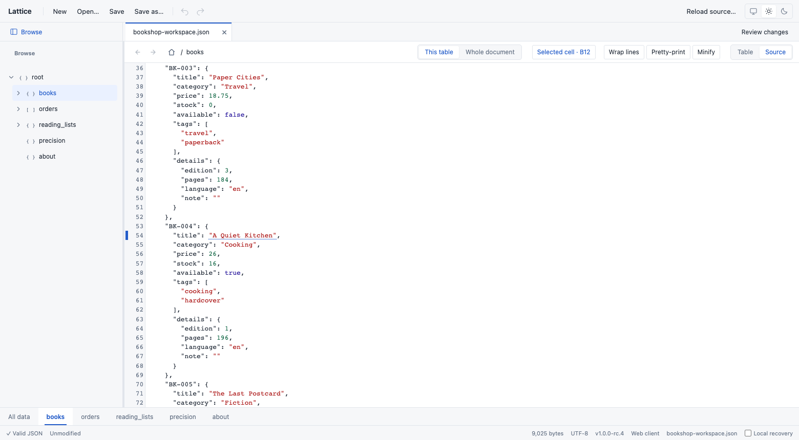

<p align="center">
  
</p>
<h1 align="center">Lattice</h1>
<p align="center"><strong>Edit JSON like a spreadsheet.</strong></p>
<p align="center">Sort, filter and edit your data. Explore nested values. Review every change.</p>
<p align="center">
  <a href="https://arsxd.github.io/lattice/"><strong>Open the app</strong></a> ·
  <a href="https://github.com/arsxd/lattice/releases/download/v1.0.0-rc.5/Lattice-Offline.html"><strong>Download HTML</strong></a> ·
  <a href="docs/USER-GUIDE.md">User guide</a>
</p>


**A browser app, an installable PWA, or one HTML file you can keep.** Lattice processes JSON locally; no document-upload endpoint or analytics integration is implemented. No account is required.

Current release: **[v1.0.0-rc.5](https://github.com/arsxd/lattice/releases/tag/v1.0.0-rc.5)**. This is a release candidate. Experimental grouped/merged sheets are excluded.

## Start in seconds

| Use it your way     | How                                                                                                                                                                                        |
| ------------------- | ------------------------------------------------------------------------------------------------------------------------------------------------------------------------------------------ |
| In your browser     | [Open Lattice](https://arsxd.github.io/lattice/), then open a JSON file or try **Explore sample workspace**.                                                                               |
| As a single file    | [Download Lattice-Offline.html](https://github.com/arsxd/lattice/releases/download/v1.0.0-rc.5/Lattice-Offline.html) and open it in a desktop browser. No Node.js, server or installation. |
| As an installed app | Open the hosted app and use the browser's install option when available. Load it online once so the app can be cached for offline use.                                                     |

Open or drag in a JSON file, edit it, then **Save** where supported or **Download** an edited copy. File access and installation depend on the browser. [Installation, saving and updates](docs/USER-GUIDE.md#save-download-and-reload)

## Work with the data

| Feature               | What it does                                                                                                                                    |
| --------------------- | ----------------------------------------------------------------------------------------------------------------------------------------------- |
| Spreadsheet editing   | Edit values and object keys, select rows/columns/ranges, and copy/paste with familiar shortcuts. Add rows or columns; resize and freeze them.   |
| Sort, filter and Find | Combine column filters, sort without reordering the JSON, highlight search matches, and step through matching cells. Match case or whole words. |
| Nested JSON           | Read bounded inline previews, wrap text, inspect small contents tables in Details, or open an object/array as its own sheet.                    |
| A useful value bar    | Edit the selected value directly, expand long contents, and distinguish `"0"` from `0`. Change types explicitly in Details.                     |
| Multiple documents    | Open files in separate tabs, browse their structure, and navigate between nested sections.                                                      |
| Exact numeric tokens  | Retain spelling such as `9007199254740993`, `1e400` and `-0` instead of round-tripping through JavaScript numbers.                              |

### Source when you need it

Source opens at the selected value, with an exact-range underline and gutter marker. Work with **This table** or **Whole document**; **Wrap lines** changes only the view. **Pretty-print** and **Minify** create undoable drafts without changing value tokens. Apply the draft when ready.



### Review before saving

Compare the saved/opened version with the current draft. Navigate changes, collapse unchanged lines, edit the draft, or restore one changed region. JSON validation checks the draft before Apply.


## Local files, clear limits

- File contents are processed locally. **Local recovery** is optional, off by default, and stores unsaved drafts in this browser when enabled.
- Browser file handles allow Save when supported and permitted. Download exports a copy; it cannot confirm that the copy reached disk. Full folder paths are not available to the web app.
- Input accepts UTF-8 files up to **64 MiB**, with depth and indexing limits. This is an input ceiling, not a promise that every file near that size will be responsive.
- Tables use **500-row pages**, up to **200 record fields**, and **10,000-cell bulk operations**. There is no formula evaluation or JSON Schema validation.

[Full limits and historical measurements](docs/PERFORMANCE.md) · [File access and recovery](docs/USER-GUIDE.md#save-download-and-reload) · [Browser verification](docs/WINDOWS.md)

## Examples and documentation

The bundled fictional bookshop covers keyed records, orders, arrays, nested details, empty values and precise numbers. Try **Explore sample workspace**, or [download an example JSON](examples/README.md).

- [User guide](docs/USER-GUIDE.md): editing, Source, Review, saving, recovery and shortcuts.
- [Documentation index](docs/README.md): architecture, browser checks, accessibility and performance.
- [Release-candidate checklist](docs/RELEASE-CANDIDATE.md): what is tested and what still needs manual validation.
- [Report a bug](https://github.com/arsxd/lattice/issues/new?template=bug_report.md): include the version, browser and a small synthetic example.

## Develop

Node.js **24+** is required for development, not for using the downloaded app.

```sh
npm ci
npm run web:dev
```

| Command                 | Output                                          |
| ----------------------- | ----------------------------------------------- |
| `npm test`              | Unit and engine regression checks               |
| `npm run test:browser`  | Chromium workflows against a production preview |
| `npm run offline:build` | Standalone `output/Lattice-Offline.html`        |
| `npm run pwa:build`     | Hosted/PWA files in `dist/`                     |
| `npm run bench:browser` | Browser workflow measurements                   |

See [Contributing](CONTRIBUTING.md). Main is protected by a pull request and verification on Linux, Windows and macOS.

## Open source and support

Project code uses [0BSD](LICENSE): reuse does not require attribution or retaining the project license notice. Bundled dependencies keep their own licenses; [third-party notices](public/third-party-notices.txt) are included with the app.

<a href="https://github.com/arsxd/lattice"> Star on GitHub</a> if Lattice is useful to you, or <a href="https://buymeacoffee.com/arshaaad"> buy me a coffee</a> to support development. Bug reports and reproducible examples help too.
