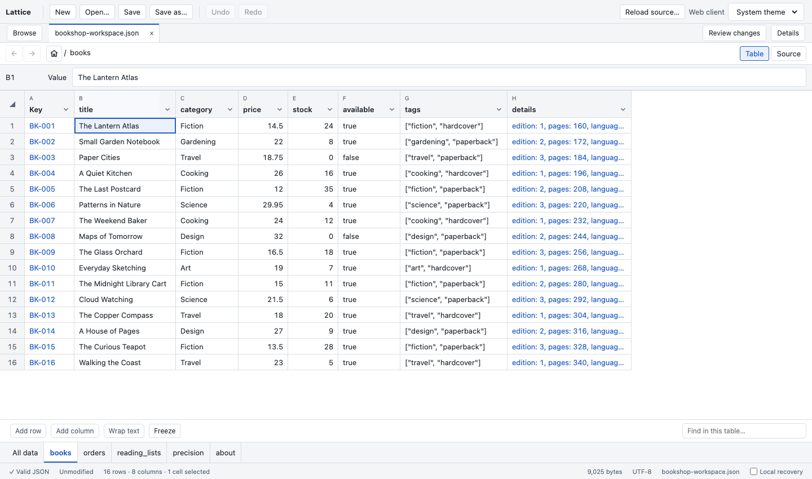
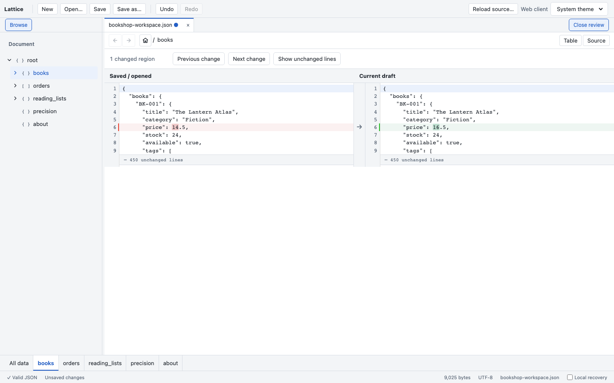

# Lattice — JSON Workbench

JSON, laid out like a spreadsheet. Open a local file, edit cells and nested tables, then review the source changes.

[Open Lattice](https://arsxd.github.io/lattice/) · [Download offline HTML](https://github.com/arsxd/lattice/releases/download/v0.1.9/Lattice-Offline.html) · [Releases](https://github.com/arsxd/lattice/releases)

## Use

Open Lattice in your browser, or download `Lattice-Offline.html` and open it directly. Choose **Open JSON file…**, **New document**, or **Explore sample workspace**. Save with supported browser file access, or Download an edited copy. The offline HTML requires no installation, Node or local server.

The hosted app can also be installed through a supported browser. Load it online once before using it offline. When an update is available, save your work and close all Lattice windows and tabs before reopening.

## Features

- Spreadsheet-style editing for JSON values, object keys and nested tables.
- Document tabs, sheet navigation, row and column operations.
- Range selection, TSV copy/paste and fill-down.
- Column sorting and combined value filters.
- Simple arrays inside cells and exact numeric tokens.
- Source editing and before/after review with per-change restore, validation and undo.
- Frozen rows and columns, resizable panes and multiline previews.
- Optional local draft recovery.





## Files and browser support

Documents are processed locally; no document-upload endpoint or analytics integration is implemented. Browser Save requires API support and permission; Download is the fallback. Local recovery is off by default and, when enabled, stores unsaved drafts in this browser. It does not replace saving. External-file conflict detection and close/reload warnings have limits; keep a separate copy of important files.

Input limits are UTF-8, 64 MiB and 256 nesting levels. Tables use 500-row pages and support up to 200 record fields, 10,000-cell bulk operations and 2,000 distinct checklist values. Paste cannot grow a table. There is no formula evaluation or schema validation. See the [measured performance and limitations](docs/PERFORMANCE.md) and [user guide](docs/USER-GUIDE.md) for details and [browser checks](docs/WINDOWS.md) for verification steps.

## Examples

The bundled sample is a fictional bookshop with a keyed catalogue, orders, reading lists, nested details and precision-sensitive numbers. [Additional examples](examples/README.md) include store orders, application settings, JSON value shapes and a before/after review pair.

## Develop

Node 24+ is the documented development requirement.

```sh
npm ci
npm run web:dev
```

| Command                 | Purpose                                      |
| ----------------------- | -------------------------------------------- |
| `npm test`              | Unit and regression checks                   |
| `npm run test:browser`  | Chromium browser workflows                   |
| `npm run offline:build` | Self-contained `output/Lattice-Offline.html` |
| `npm run web:build`     | Static site in `dist/`                       |
| `npm run web:preview`   | Preview the built site                       |
| `npm run bench`         | Machine-specific engine benchmark            |

Read [CONTRIBUTING.md](CONTRIBUTING.md), [the web guide](docs/WEB.md), [keyboard checks](docs/ACCESSIBILITY.md) and [CHANGELOG.md](CHANGELOG.md). Report issues through the [bug report form](https://github.com/arsxd/lattice/issues/new?template=bug_report.md).

Third-party license notices are included in the [distribution](public/third-party-notices.txt) and embedded in the standalone HTML. No project license has been selected; public source availability alone does not grant an open-source license.
