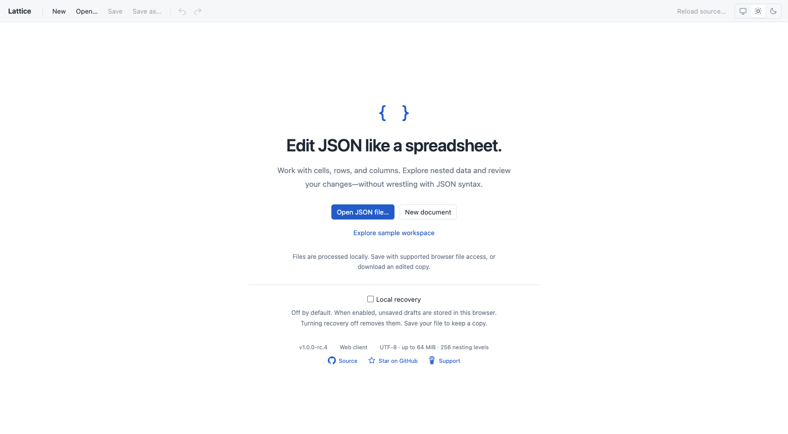
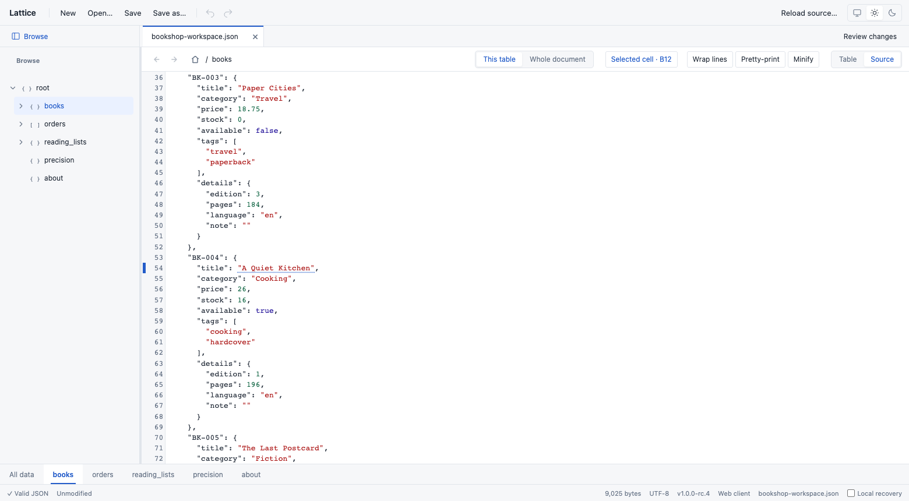
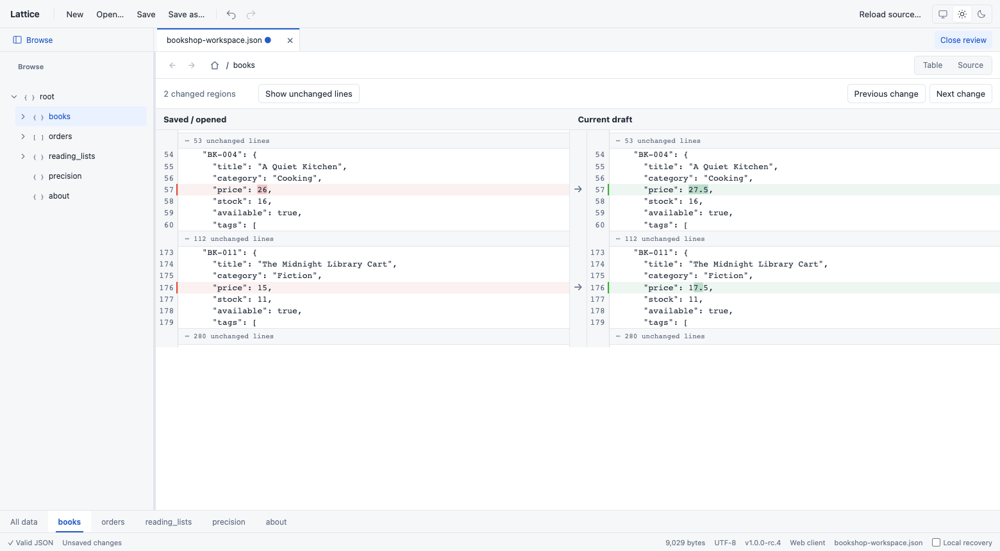

# Using Lattice

[Open the app](https://arsxd.github.io/lattice/) · [Download rc.11 HTML](https://github.com/arsxd/lattice/releases/download/v1.0.0-rc.11/Lattice-Offline.html) · [Documentation](README.md)

## Open your first document

Open a JSON file, drop it onto the app, or choose **Try sample**. The downloaded HTML opens directly in a desktop browser; no Node.js or server is needed. Try the fictional sample to get familiar with editing and Save/Download.

Each file opens in a document tab with its own worker and undo history. A drop can contain up to eight files totalling 64 MiB. Finish an active cell edit before dropping more files. Invalid or empty JSON opens in Source with an explanation; the original text is retained for repair.

The bottom tabs expose document sections. Choose **+** at the end of the sheet tabs to add and open an empty table alongside the existing sheets. Object documents ask for a name. In a root array, the new sheet uses the next index. **Browse** shows the structure; breadcrumbs, Back, Forward and Home navigate it. Objects and arrays can open as separate tables. Duplicate object keys are rejected.

## Edit cells and keys

Click once to select, then type to replace the value. Double-click a value or press **F2** to edit from the end. **Enter** commits and moves down; **Shift+Enter** moves up. **Tab** moves right and **Shift+Tab** left. **Escape** cancels. Clicking away applies valid cell/value-bar input; invalid input stays available for correction.

The value bar edits the selected value directly. Its chevron expands the display to a bounded height; its table icon opens a selected object or array. In the value bar, **Enter** applies, **Shift+Enter** inserts a line break, and **Escape** cancels.

| Input or state                       | Meaning                                                                            |
| ------------------------------------ | ---------------------------------------------------------------------------------- |
| `0` in the value bar                 | A JSON number                                                                      |
| `"0"` in the value bar               | A JSON string                                                                      |
| `""` entered in a cell               | Empty text                                                                         |
| A subtly shaded, blank property cell | The property is absent; it remains editable                                        |
| A blank, unshaded value cell         | Inspect Details to distinguish empty text from null |

The grid colors boolean values and uses quotes for text that looks like a JSON number, boolean, null, or empty container, such as `"334"`, `"true"`, `"null"`, `"{}"`, or `"[]"`. Empty objects and arrays appear as `{}` and `[]`. Existing values retain their type. A consistent column type guides entry into missing/null cells; otherwise these default to text. Use **Change type…** in Details to make an explicit type change. Merely opening and finishing an untouched missing cell does not create a property.

Object Key cells can be renamed; generated array indices are read-only. A key selection shows the key in the value bar. Add row creates a blank record using the existing fields; Add column asks for a property name and brings the new column into view. Right-click for relative row insertion, duplication and removal. Column rename/delete affects the full object-row table and checks name collisions.

## Read nested values

Nested cells show bounded JSON previews. Double-click/F2 edits eligible values; **Ctrl/Cmd+click**, **Open row**, or the value-bar table icon opens a container separately. Small nested contents can be inspected as a table in Details.

**Wrap text** expands only overflowing rows, up to five automatic lines for nested previews and three for ordinary values. Manually increasing row height reveals more of the loaded preview. An ellipsis signals clipped or truncated content. It does not mean the stored JSON has been shortened.

Inline/value-bar previews are bounded at 4,096 characters. Oversized values use a read-only preview so truncated text cannot overwrite the original. The compact JSON preview in Details is scrollable and stops at 8,192 characters. Source and **Copy JSON** provide complete values.

## Select, copy and paste

Select a cell, drag a range, or extend with Shift+click / Shift+arrows. Column letters/titles select across **all matching rows**, including other pages. Row numbers select rows; the corner selects the table. Ctrl/Cmd-click adds or removes row/column ranges.

Row labels start at 1 and follow the current display order. JSON array indices start at 0 and identify the original array positions, even after sorting or filtering. Right-click a column header and choose **Show original index** to display the original positions. Details also shows the selected row’s original index. Real properties named `index`, `id` or `type` remain ordinary data. Mixed collections may have a generated **Array value** column marked **view**; it cannot be renamed/deleted as a real property.

| Action                | Shortcut                      |
| --------------------- | ----------------------------- |
| Open JSON file        | Ctrl/Cmd+O                    |
| Save / Download       | Ctrl/Cmd+S                    |
| Save as (when shown)  | Ctrl/Cmd+Shift+S              |
| Copy / paste values   | Ctrl/Cmd+C / Ctrl/Cmd+V       |
| Fill down             | Ctrl/Cmd+D                    |
| Select current column | Ctrl+Space                    |
| Select current row    | Shift+Space                   |
| Select table          | Ctrl/Cmd+A                    |
| Edit / cancel         | F2 / Escape                   |
| Document undo / redo  | Ctrl/Cmd+Z / Ctrl/Cmd+Shift+Z |

Clipboard values use quoted TSV compatible with spreadsheet cells. Copy uses complete values, not cell previews. Hold **Alt** (**Option** on macOS) to reveal shortcut letters. **Alt+A** adds a row and **Alt+C** opens Add column. **Alt+O** toggles Browse and **Alt+L** toggles Details in Table view. **Alt+U** opens Source, **Alt+G** opens or closes Review changes, and **Alt+W** toggles wrapping in Table or Source. In an open context menu, release Alt and press the underlined letter, such as **D** to duplicate a row. Use **Shift+E** for Delete in that menu. Copy and Paste from the context menu depend on clipboard permission. Inside a text editor, normal browser text selection applies.

Paste validates the entire operation before applying it as one undo step. It does not grow the table. It can cross pages within the filtered/sorted table, but requires one adjacent destination and compatible writable cells. Empty pasted text stays empty text in a string cell; in non-string cells, blank paste becomes null. Fill down repeats the top selected value; it does not generate a numeric series.

Bulk operations are limited to 10,000 cells and 16,777,216 value characters. Larger ranges can be highlighted, but copying asks for a smaller range. Disjoint row/column ranges copy in table order.

Click unused sheet space to clear selection. Click a column letter to select its cells, or click a column title to select only the name. **⌘/Ctrl+C** and the context menu’s **Copy** follow that selection. Use the header chevron to sort or filter. Right-click a row number or column header for actions on that row or column. Right-click a cell with a nested object or array and choose **Open as table** to explore it.

## Sort, filter and Find

Use the header chevron for ascending/descending sort and a searchable value checklist. A filtered column shows a **funnel**. Filters combine across columns; sorting changes the view, not the JSON order. Clicking a different header selects it without transferring the sort.

Active **Sort** and **Filters** controls appear beside Table/Source. Use their × actions to clear sort or all filters. Open Filters to inspect active columns and clear one. Checklists show up to 2,000 distinct values and report truncation.

**Find in this table** highlights matches and shows the number of matching **cells**, not individual text occurrences. Use its previous/next buttons, **Enter** / **Shift+Enter**, **Match case** and **Match whole word**. Find filters matching rows separately from column checklists. Find searches full nested values and can show a snippet when a match is beyond the cell preview. The query and matching options carry across sheets within the open file. Each sheet shows its own matches. Searches stay separate across files.

## Source

Select a cell and choose **Source** to locate its exact JSON. A single selected row opens with the **Selected row** scope. For several rows, Source opens the sheet and jumps to the first selected row. Choose **Find** or press **⌘/Ctrl+F** in the editor to search the current Source scope. Missing properties have no token. A dotted underline marks the exact value; a gutter bar shows its lines. **Go to B4** scrolls back to the linked value without selecting text. Ordinary edits track its range; formatting clears the location marker because it replaces the entire draft.

| Control                                         | Effect                                                                                                                                     |
| ----------------------------------------------- | ------------------------------------------------------------------------------------------------------------------------------------------ |
| Selected value / Current sheet / Whole document | Source opens the selected nested value by default. Choose Current sheet to edit the open table, or Whole document to edit the entire file. |
| Wrap lines                                      | Visually wrap long lines; JSON, logical line numbers and draft status do not change.                                                       |
| Pretty-print                                    | Add two-space indentation in an undoable draft.                                                                                            |
| Compact                                         | Keep short objects and arrays inline, with a 120-character line target and two-space indentation.                                          |
| Minify                                          | Remove whitespace outside strings in an undoable draft.                                                                                    |
| Apply source                                    | Validate and commit the draft to the document engine.                                                                                      |
| Discard draft                                   | Restore the committed text, retaining earlier table edits.                                                                                 |

Formatting preserves exact numeric tokens, string contents and property order. Compact keeps the outer container multiline and expands nested containers when needed. Long primitive arrays pack several values per line; object records stay separate. It does not split long strings to meet its line target. Apply or discard a draft before changing scope, returning to Table or saving. Applying a table draft changes only that subtree, keeping sibling data intact. Applying a draft is distinct from saving the file to disk.

Source automatically pairs JSON quotes, braces and brackets while typing. Typing an automatically inserted closing character moves past it; Backspace removes an empty pair. Paste and ordinary cell editing are unchanged.

Source shows advisory syntax squiggles after a short typing pause. Hover an underline, error gutter dot, or affected line number for an explanation. Checks run in a worker and outdated results clear when editing resumes; no error banner interrupts typing. Apply validates again before committing; an invalid draft remains available for repair, with a readable error and optional parser details. Resuming editing clears the previous Apply error.

Menus and controls use brief motion. Your system’s Reduce Motion setting disables these effects; cell selection, typing and scrolling stay immediate.

## Review changes

**Review changes** compares the opened/saved baseline on the left with the current editable draft on the right.

- **Previous / Next change** navigates changed regions.
- **Show / Hide unchanged lines** expands or collapses context, including context expanded manually.
- A right-pointing **restore arrow** copies that baseline region into the draft. Hovering it marks the affected region. It does not save or immediately change the table.
- **Apply changes** validates and commits a changed draft as one document undo step. **Discard draft** returns to the committed document while retaining earlier table edits.

Use Ctrl/Cmd+Z and Ctrl/Cmd+Shift+Z for draft undo/redo, including restoration. Review validates automatically in a worker; only blocking errors appear. **Close review** returns to the previous view and asks before discarding an unapplied draft. Drafts survive document-tab switching.

Review compares with the stored baseline, not a newly modified disk file; it is not a three-way merge. If comparison exceeds its work budget, highlighting/restoration pause with an explanation instead of showing an approximate broad replacement. Locally recovered drafts have no stored original baseline: Review stays unavailable until a confirmed save establishes one.

## Save, Download and Reload

| Action      | Behavior                                                                                         |
| ----------- | ------------------------------------------------------------------------------------------------ |
| Save        | Write back through a retained file handle where the browser supports and permits it.             |
| Save as…    | Choose a destination through a supported browser picker.                                         |
| Download    | Export an edited copy. The app cannot confirm it reached disk, so the document remains unsaved.  |
| Reload file | Read the retained source again, or ask you to select it again when direct access is unavailable. |

Cancelled or failed writes do not mark a document saved. Save compares the decoded disk contents with its baseline and blocks a detected external change. It provides conflict detection, not an exclusive file lock or automatic watcher.

Press **Alt+R** (**Option+R** on macOS) outside a text field to reload the active file. Reload affects only the active document and resets undo/navigation history. It retains the current table or nearest surviving parent, remaps sort/filter columns by name and role, and restores the selected path/page and compatible scroll position when possible. Removed/filtered cells clear selection; ranges collapse to their active cell. Array paths identify positions, not semantic record identity after external reordering. Cancel retains your work.

Busy operations show a small spinning ring and disable repeated requests. The status bar briefly confirms a successful reload.

Click or right-click the bottom filename for **file information** and **Copy filename**. Standard web APIs do not provide absolute disk paths. A picker may remember a previous location where the browser permits it, but that is not a guarantee of persistent access.

## Layout and themes

Resize columns at header edges and rows at their lower number-cell edge. Titles wrap independently of cell contents. Initial widths sample up to 50 displayed rows, remain bounded for wide tables and use spare width for longer two-column values. Manual sizes take precedence.

Toggle **Browse** / **Details** and drag their boundaries to resize them. Focus a boundary and use Left/Right for keyboard resizing; Home or double-click resets it. Details can occupy up to half a wide window and overlays at narrower sizes. Pane widths are local preferences.

Freeze first/selected rows or columns through **Freeze**. Freezing uses a prefix through the selected boundary, not independent scattered rows. Frozen rows are limited to 40% of grid height and pages of at most 10,000 rendered cells, including the gutter; frozen columns must leave 40% of the width scrollable. Unsafe freezes pause after resizing/wrapping instead of compromising the view.

Use the System, Light and Dark controls in the top-right corner to choose a theme. See [accessibility checks](ACCESSIBILITY.md) for tested keyboard behavior and remaining manual checks.

## Optional recovery

**Local recovery** is off by default. Enable it on the home screen or status bar to keep unsaved document text in this browser's IndexedDB. It requires Web Locks to separate active windows safely; storage errors are reported.

After edits settle for two seconds, committed table edits and Source/Review drafts—including incomplete JSON—are checkpointed. In-progress cell text is not stored until committed. On reopening, choose **Restore draft** or **Discard recovered draft**. Restore adopts the checkpoint before deleting the old record.

Recovery does not reconnect file handles, restore undo history or replace saving. Turning it off clears recovery records without changing open documents. A crash before the debounce, storage eviction or private-mode restrictions may prevent recovery. Limits are 64 MiB of UTF-16 text/name memory per document and 128 MiB across windows; these are separate from file-byte limits.

## Installation and updates

Install the hosted app through a supported browser's prompt or menu. Load it online once and let caching complete before going offline. The service worker caches app assets, not your JSON files.

**Update available** means a newer cached app is waiting. If **Update now** is available, save your work, close the documents in that window, then choose **Update now**. In older builds, close every Lattice tab and app window after saving, then reopen. **Keep working** dismisses the explanation without reloading. Offline update checks wait for connectivity.

The standalone HTML has no service worker. To update it, download the newer release, save your work, close the old file and open the new one. Replacing an HTML file does not update an already open tab.

## Limits and reporting issues

Input limits are UTF-8, 64 MiB, 256 nesting levels and a four-million-token indexing budget. Tables use 500-row pages and support up to 200 record fields. These limits are not a responsiveness guarantee. Details tables cap 20 rows, 10 columns, 100 cells, 32,768 source characters and 12 AST levels. There is no formula evaluation or JSON Schema validation.

See [performance evidence](PERFORMANCE.md), [browser checks](WINDOWS.md) and the [release-candidate checklist](RELEASE-CANDIDATE.md). Report the version from the home footer/status bar, browser/OS, expected and actual behavior, and a small synthetic example through the [bug form](https://github.com/arsxd/lattice/issues/new?template=bug_report.md). Screenshots should omit sensitive contents.
